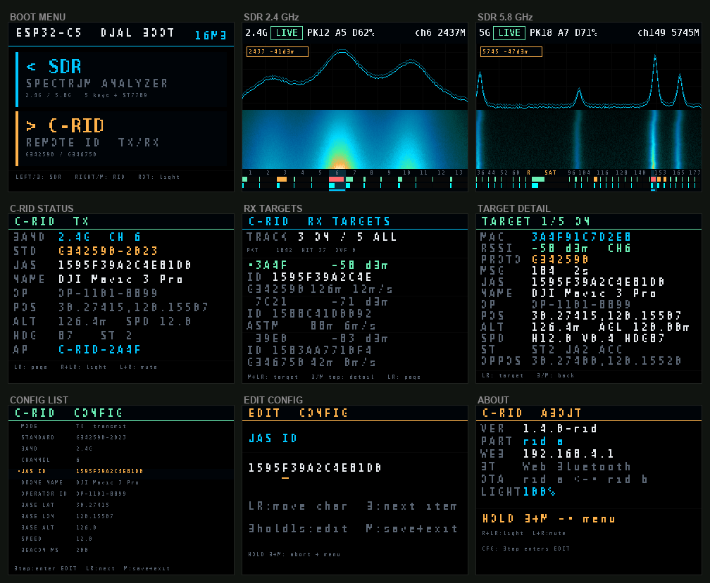

# ESP32-C5 双固件项目：SDR 频谱仪 + C-RID 远程识别（ST7789 320×240 + 5 键）

**硬件**：ESP32-C5（16 MB Flash）· 3.2" ST7789 240×320 SPI 屏（横屏使用）· 5 个按键 · 蜂鸣器

把两个项目合成**一个可烧录的 16 MB 镜像**，开机用同一块 ST7789 屏和 5 个按键选择进入哪套固件：

- `←` 进入 **SDR 频谱仪**（esp-sdr `tft` 分支的 C5 固件）
- `→` 进入 **C-RID**（China Remote ID 扫描/模拟固件，新增本地 TFT 显示）

两套功能各自是**独立编译的 app 镜像**，运行时互不加载、互不干扰；只在每次开机时做一次选择。

## 配套客户端

显示屏不是唯一能看数据的地方。两套固件都保留了各自的上位机通道，本地 TFT 只是多一路显示。

**SDR 频谱仪**：本固件完整保留 esp-sdr 的串口协议（`INFO` / `FREQ` / `GAIN` / `CAP16`…），所以下面两个客户端都能直接连：

| 客户端 | 平台 | 连接方式 |
|---|---|---|
| [ESP32_C5_Wifi_spectrum_analyzer](https://github.com/sd1471123/ESP32_C5_Wifi_spectrum_analyzer) | Windows / Linux（Python + Qt） | USB 线接板子的 **USB（native）** 口，选 COM 口连接；走 UART/CH343 口也行，速度约一半 |
| [ESP32_C5_Wifi_SDR_android](https://github.com/sd1471123/ESP32_C5_Wifi_SDR_android) | Android（USB OTG） | 用**数据线**接同一个 USB 口（OTG 转接头或 OTG 线）；手机供电不足时用带电源的 OTG 分线或 Y 线 |

名字里的 "Wi-Fi" 指的是**它分析 Wi-Fi 频段**，数据并不走无线：电脑插 USB 线、手机插 USB OTG 数据线，**两边都必须有线**——这块板子的 Wi-Fi 射频整个让给了频谱采样，没有富余链路去传数据。

本地 TFT 与客户端可以同时用：板子继续自己画频谱，客户端发 `CAP16` 抓数据时会短暂接管射频，抓完再还给 UI。

> **别用客户端的 `flash_c5.py` 刷这块板子**：那会写入官方 esp-sdr 单固件，把双启动菜单和 C-RID 一起覆盖掉。客户端只需要连已经刷好的串口，不用刷机。

**C-RID**：板子开 softAP，两种方式都行：

| 方式 | 说明 |
|---|---|
| 浏览器 | 手机/电脑连 C-RID 的热点（名字以 `ESP32-CRID-` 开头），打开 <https://192.168.4.1>（**是 https**，80 端口只做跳转）。**默认 WiFi 密码请到我的项目说明里查看**：[esp32-ChinaRemoteID_Scan_Sim](https://github.com/sd1471123/esp32-ChinaRemoteID_Scan_Sim) |
| Android | [esp32-ChinaRemoteID_Scan_Sim](https://github.com/sd1471123/esp32-ChinaRemoteID_Scan_Sim) 仓库的 `android/` 目录（APK 也在它的 Releases 里）。BLE 优先，没连蓝牙时回落到热点 HTTPS；**OTA 升级必须连热点**，BLE 传不动 1.3 MB 的固件 |

## 界面预览



上面是**模拟渲染**图，不是相机拍屏：像素由固件自己的字库（`font5x7` / `font7x12`）和页面里写死的坐标逐个画出来，所以字号、行距、每行能塞多少字、灰阶配色都与实物一致，只是没有 IPS 视角、背光溢出这类光学效果。这样也方便改了 UI 之后重新出图对照。

九宫格按使用顺序排列：开机菜单 → SDR 两个频段 → C-RID 状态 / 目标 / 详情 / 配置 / 关于。

| 页面 | 截图 |
|---|---|
| 开机菜单（`←`/`B` 进 SDR，`→`/`M` 进 C-RID） | [`01-boot-menu.png`](docs/screens/01-boot-menu.png) |
| SDR 2.4 GHz：三个宽峰 + 13 格等分信道条 | [`02-sdr-2g4.png`](docs/screens/02-sdr-2g4.png) |
| SDR 5.8 GHz：窄峰群 + 29 格频率轴，带 RADAR / SAT / ISM 区段 | [`03-sdr-5g8.png`](docs/screens/03-sdr-5g8.png) |
| C-RID 状态页（参数总览） | [`04-rid-status.png`](docs/screens/04-rid-status.png) |
| C-RID 接收目标列表 | [`05-rid-targets.png`](docs/screens/05-rid-targets.png) |
| 目标详情（12 行字段，只刷数值） | [`06-rid-detail.png`](docs/screens/06-rid-detail.png) |
| 配置列表 / 编辑项 | [`07-rid-config.png`](docs/screens/07-rid-config.png) · [`08-rid-edit.png`](docs/screens/08-rid-edit.png) |
| 关于页（版本 / 分区 / 背光档位） | [`09-rid-about.png`](docs/screens/09-rid-about.png) |

2.4G 和 5.8G 两张图能看出信道条的两种画法：2.4 GHz 信道间隔只有 5 MHz 但每个占 20 MHz，按频率画会互相压成一团，所以固件改成 13 个等分格；5.8 GHz 信道本来就不重叠，就直接摆到频率轴上，RADAR / SAT / ISM 三段空隙自然露出来。

重新出图（每张同时输出 1× 和 2× 两版）：

```bash
python tools/make_screenshots.py --scale 2
```

## 目录

```
C5mix/
├── launcher/          开机选择菜单（factory 分区）
├── sdr/               esp-sdr tft 分支（ota_0 分区，已打合并补丁）
├── rid/               C-RID（ota_1/ota_2 分区，已加 TFT 显示）
├── common/
│   ├── panel/         共用的 ST7789 + 5 按键 + 蜂鸣器驱动（原样取自 sdr tft 分支）
│   └── dualboot/      启动目标切换 / OTA 状态确认
├── partitions/        合并后的 16MB 分区表（各工程各有一份拷贝）
├── tools/             构建 / 烧录脚本、模拟截图、发布打包（package_release.py）
└── docs/              架构说明；docs/screens/ 是 README 用的模拟截图
```

源码基线：
- `sdr/` ← `sd1471123/esp-sdr` 的 `tft` 分支，commit `c7288b0db6e4255ca98d7a76fb12c388ad356733`
- `rid/` ← `sd1471123/esp32-ChinaRemoteID_Scan_Sim`，commit `5c50d795af86dbcd2cedfc222d8b928bde49055e`

## 硬件接线（与 esp-sdr tft 分支完全一致）

| 屏幕 8 针 | ESP32-C5 |
|---|---|
| GND | GND |
| VCC | 3V3 |
| SCL | GPIO6 |
| SDI | GPIO7 |
| RESET | GPIO5 |
| AO / DC | GPIO4 |
| CS | GPIO10 |
| BL | GPIO23（**不要直连**，用 S8050 低边开关或接 3V3 常亮） |

| 功能 | GPIO |
|---|---|
| ← | GPIO0 |
| → | GPIO1 |
| B（频段） | GPIO8 |
| M（模式） | GPIO9 |
| R（旋转） | GPIO24 |
| 蜂鸣器 | GPIO25 |

## 屏幕（显示模块）参数

下面这些是**当前固件里写死的**屏幕参数，换屏前请逐项对照，不然很可能点不亮或者花屏。

| 项目 | 参数 |
|---|---|
| 模块 | 3.2" 8 pin SPI 排针模块，丝印 `GMT032-8P-SPI`（卖家资料里也写作 `GMT320-8P`） |
| 面板类型 | IPS，**常白**（normally white），无触摸、无 TE/VSYNC 引脚 |
| 物理分辨率 | **240 × 320** 竖屏；固件固定按 **320 × 240 横屏**使用 |
| 驱动 IC | **ST7789**（ST7789V / ST7789VW 均可），初始化序列取自卖家附带的 C51 demo |
| 接口 | 4 线 SPI：SCL / SDI(MOSI) / CS / DC(A0) + RESET + BL，**只写、无 MISO** |
| SPI 时序 | **Mode 0**（CPOL=0, CPHA=0），**8 MHz**（4 MHz 为兜底档），CS 由软件手动拉低覆盖整段命令/像素流 |
| 像素格式 | **RGB565**，每像素 2 字节，**高字节先发**；驱动在 `stage[]` 里做字节交换 |
| 初始化关键值 | `0x3A = 0x05`（16bpp）、MADCTL `0x36 = 0x60` 横屏 / `0x00` 竖屏、末尾 `0x21` 开反显 |
| GRAM 偏移 | `LCD_OFS_X = 0`、`LCD_OFS_Y = 0`（240×320 面板不需要偏移） |
| 反显处理 | 面板常白，控制器再发 `0x21`，同时数据在软件里异或 `0xFFFF`（`LCD_INVERT_DATA 1`）两边抵消 |
| 刷新方式 | 无 TE 同步，靠局部刷新 + 8 MHz 减少撕裂 |
| 背光 | 白光 LED 串，3V3 供电 **约 90–95 mA**，BL 走 GPIO23 + S8050 低边开关；PWM 5 kHz / 12 bit，UI 只暴露 **10% / 100%** 两档 |

背光电流不小，**必须用三极管驱动**，直连 GPIO 会烧引脚；驱动只给 10% / 100% 两档，是因为中间占空比会让 90 mA 的脉冲去调制 3V3，屏上出现横向水波纹。

### 换屏要改哪里

驱动里留了全套编译开关，绝大多数情况**不用改代码，加 `-D` 就行**（也可直接改宏再重编）：

| 现象 | 原因 | 改法 |
|---|---|---|
| 全黑或全白，一点图形都没有 | 不是 ST7789，初始化序列不对 | 编译加 `-DLCD_CTRL_ILI9341=1`；其它 IC（ST7796 / ILI9488 / GC9A01）要自己写 `lcd_init()` 的分支 |
| 图像整体平移 N 像素，边上出现彩条或回绕 | 面板可见区在 GRAM 里的起点不同 | 改 `LCD_OFS_X` / `LCD_OFS_Y`（如 240×240 方屏要 `-DLCD_OFS_Y=80`） |
| 黑底变白底、UI 一片惨白 | 面板常黑/常白与当前设置相反 | `-DLCD_INVERT_DATA=0`，并把 init 末尾 `0x21` 改成 `0x20` |
| 红蓝互换 | 面板是 BGR 排布 | MADCTL 加 `0x08`：横屏 `0x60 → 0x68`，竖屏 `0x00 → 0x08` |
| 画面镜像，或横竖屏方向搞反 | MADCTL 旋转位不对 | 改 `LCD_MADCTL_LAND` / `LCD_MADCTL_PORT`（MX/MY/MV 三位组合） |
| 花屏、雪花、随机竖线 | SPI 太快或杜邦线太长、共地不良 | `-DLCD_SPI_HZ=4000000`；缩短排线、就近加 100 nF |
| 完全无反应 | SCL/SDI 或 RES/AO 这两对相邻针接反 | 先用 `-DLCD_SWAP_SCL_SDI=1` / `-DLCD_SWAP_DC_RST=1` 软件验证，再改线 |
| 能显示但文字/布局错位 | UI 坐标是按 320×240 写死的 | 改 `common/panel/panel_draw.h` 的 `PANEL_W` / `PANEL_H`，再逐个核对 `rid/main/crid_lcd.c`、`launcher/main/main.c`、`sdr/` 的 `ui.c` 里写死的行高、标题栏 22 px、列 x 坐标 |

换屏前建议先把 `LCD_SELFTEST` 设为 1 重编一次：它会依次刷红/绿/蓝/白/黑满屏，再画一圈 1 px 边框。边框四边都贴住屏幕边缘，说明总线、窗口、MADCTL 三项都对；边框被切掉或回绕，就直接调 offset。

**其它尺寸能不能用**：

- **240×320 任何尺寸**（2.0" / 2.4" / 2.8" / 3.2"）——只要 IC 是 ST7789、8 pin SPI，**直接换，代码不用动**，只是可视面积变大变小。
- **240×240 方屏**——要加 `LCD_OFS_Y=80`，另外 UI 按 240 高排的版会挤，得手工调坐标。
- **320×480 / 240×320 以外的分辨率**（ST7796、ILI9488 等）——**不能直接用**：要写新的 init 序列，并且整套 UI 布局（行数、字号、列宽）都得重排。

### 驱动文件在哪

同一个驱动有**两份拷贝**，改参数时两份都要改，否则会出现「菜单正常、进了 SDR 就花屏」这种怪现象：

| 文件 | 谁在用 | 引脚定义 |
|---|---|---|
| `common/panel/st7789.c` | launcher、C-RID | `common/panel/board_c5_lcd.h` |
| `sdr/main/local_ui/st7789.c` | SDR 固件 | `sdr/main/local_ui/board_c5_lcd.h` |

`st7789.c` 顶部集中放着 `LCD_SPI_HZ`、`LCD_OFS_X/Y`、`LCD_INVERT_DATA`、`LCD_MADCTL_LAND/PORT`、`LCD_CTRL_ILI9341`、`LCD_SWAP_*`、`LCD_SELFTEST`，全部带 `#ifndef`，所以命令行 `-D` 覆盖比改源码更安全。

## 按键用法

| 场景 | 按键 |
|---|---|
| 开机菜单 | `←` 或 `B` = 进 SDR；`→` 或 `M` = 进 C-RID；`R` = 切背光 |
| SDR 固件 | 原有全部操作不变：`←/→` 走信道，`B` 切频段，`M` 切模式，`R` 短按转屏 / 长按 **5 秒**恢复出厂 |
| SDR 固件 | 组合键：`B + ←/→` 调上限、`M + ←/→` 调下限、`R + ←/→` 切背光、`← + →` 同时静音（静音状态存 NVS，开机延续） |
| SDR 固件 | **新增**：`B + M` 同时按住 1.5 秒 → 回开机菜单 |
| C-RID 固件 | `←/→` 翻显示页（状态 / 目标 / 关于 / **配置**）；目标页 `M + ←/→` 或 `B + ←/→` 翻航迹；**目标页点按 `M` 或 `B` 进入该目标详情页**（12 行大字：MAC / RSSI+信道 / 协议 / 报文数+时效 / UAS ID / 机型 / 操作员 / 坐标 / 高度+AGL / 速度+航向 / 状态+UA 类型 / 飞手位置；标签固定不动、只刷数值），详情页 `←/→` 切换目标、再点按 `M` 或 `B` 返回列表；`R + ←/→` 切背光；`← + →` 同时静音（静音状态存 NVS，开机延续） |
| C-RID 固件 | **配置页**：列表态 `←/→` 选项目、点按 `B` 进 EDIT 页；**EDIT 页编辑完态**：点按 `B` 切下一项，字符串项（UAS ID / 机型名 / 操作员 ID）用 `←/→` 移动字符光标、数值项用 `←/→` 直接改值，长按 `B` 1 秒进改值态；**改值态**：`←/→` 改当前字符/数值、字符串项点按 `B` 移下一字符、`M` 退回编辑完态；列表态或编辑完态按 `M` = 保存全部并立即生效、退回状态页；12 项含收发模式、标准、频段、信道、UAS ID、机型名、操作员 ID、经纬度、海拔、速度、广播间隔 |
| C-RID 固件 | **新增**：`B + M` 同时按住 1.5 秒 → 回开机菜单（配置页里相当于放弃未保存的修改）；`R` 点按仅蜂鸣、长按无功能 |

C-RID 的网页配置入口（`https://192.168.4.1`）和 BLE 数据通道完全保留，TFT 只是多一路本地显示；连接方式见上面的「配套客户端」。

## 分区布局（16 MB Flash）

| 分区 | 类型 | 偏移 | 大小 | 内容 |
|---|---|---|---|---|
| factory | app | `0x20000` | 1 MB | launcher 菜单 |
| sdr | app/ota_0 | `0x120000` | 2 MB | SDR 固件 |
| rid_a | app/ota_1 | `0x320000` | 3 MB | C-RID 固件 A |
| rid_b | app/ota_2 | `0x620000` | 3 MB | C-RID 固件 B（网页 OTA 目标） |
| ridlog | data/0x40 | `0x920000` | 4 MB | C-RID 接收轨迹 |
| nvs / phy_init / otadata | data | `0x9000` 起 | — | 配置 / 射频校准 / 启动槽 |

**为什么每次开机都能回到菜单**：launcher 放在 `factory`；被选中的固件启动后立刻调用
`esp_ota_set_boot_partition(factory)`，在 ESP-IDF 里这等价于擦空 `otadata`，
于是下一次冷启动 bootloader 又去启动 factory。详见 `docs/ARCHITECTURE.md`。

## 构建与烧录

**不想自己编译**：到 [Releases](https://github.com/sd1471123/esp32c5-sdr-rid-dualboot/releases) 下现成的镜像，一条命令烧完（会清空 NVS）：

```bash
python -m esptool --chip esp32c5 -p COM5 -b 460800 \
    write_flash 0x0 esp32c5-sdr-rid-dualboot-v0.0.1-full-16mb.bin
```

同一页的 `...-parts.zip` 里是分体 bin 和一张 `FLASH.txt` 地址表，只想更新 C-RID 或想保留 NVS 设置时用；`SHA256SUMS.txt` 是校验和。

自己编译需要 ESP-IDF **6.x**（本机为 `D:\esp-idf-v6.1`），且已装好 C5 工具链。脚本会自动剥离 MSYS 的
`MSYSTEM` 变量，所以可以直接从 Git Bash 跑。

```bash
# Git Bash：先设好 IDF_PATH / IDF_PYTHON_ENV_PATH，或先 source ESP-IDF 的 export.sh
bash tools/build_all.sh
bash tools/flash_all.sh -p COM6          # 整片烧录，会清 NVS
python tools/package_release.py --version v0.02   # 出发布包：整片镜像 + 分体 zip + 校验和
```

PowerShell：

```powershell
powershell -ExecutionPolicy Bypass -File tools\build_all.ps1
powershell -ExecutionPolicy Bypass -File tools\flash_all.ps1 -p COM6
```

烧录地址（C5 的 bootloader 在 **0x2000**，不是 0x0）：

```
0x2000   out/bootloader.bin
0x8000   out/partition-table.bin
0x10000  out/ota_data_initial.bin     # 空的 otadata，保证开机进菜单
0x20000  out/launcher.bin
0x120000 out/sdr.bin
0x320000 out/rid_a.bin
0x620000 out/rid_b.bin
```

本机已用 ESP-IDF 6.1 实际编译通过三个工程：launcher `0x39340`、SDR `0xd85b0`、
RID `0x1b1eb0` 字节（加本地配置页后增大）。RID 构建末尾会出现一条
`Part 'factory' 0/0 @ 0x20000 size 0x100000 (overflow ...)` 警告——那是共用分区表里
1 MB 的 launcher 槽装不下 RID 镜像，**是预期的**：RID 只会烧进 3 MB 的 `rid_a` / `rid_b`，
不影响使用。

## 各工程改了什么

**launcher（新建）**
- 复用 sdr tft 分支的 `st7789.c` / `buttons.c` / `buzzer.c` / 字库，接线一字不改。
- 画两行大字菜单，按左/右键设置启动分区后重启。

**sdr/**
- `sdkconfig.defaults.esp32c5`：2 MB → 16 MB Flash，指向合并分区表，打开回滚。
- `main/families/c5_c6_c61/receiver.c`：启动时确认 OTA 状态并把启动目标还给 launcher。
- `main/local_ui/ui.c`：新增 B+M 长按回菜单；其余 UI 逻辑未动。
- 根目录 CMake 增加 `../common/dualboot` 组件。

**rid/**
- `sdkconfig.defaults` / 分区表：指向合并分区表。
- `main/crid_ota.c`：网页 OTA 的写入目标从“自动轮换三个 ota 槽”改为**只在 rid_a / rid_b 之间轮换**，
  避免 OTA 把 SDR 固件覆盖掉。
- `main/crid-sim.c`：启动确认 OTA 状态 + 交还启动目标；启动本地 TFT 任务。
- `main/crid_lcd.c`（新增）：四页本地显示（状态 / 接收目标 / 关于 / **配置**）；配置页用按键改 12 项参数并保存到 NVS，保存后复用网页那套逻辑重建 AP / 应用收发开关，立即生效。
- 根目录 CMake 增加 `../common/panel` 与 `../common/dualboot` 组件。

## 已知边界

- 两套固件**从不同时运行**；RID 的 Wi-Fi/BLE 与 SDR 的射频/PHY 不会互相抢资源。
- NVS 共用一个分区，但命名空间不同（`sdr_ui` / `crid` / `cridlog`），设置互不覆盖。
- 从网页 OTA 升级 C-RID 时，上传的必须是 `rid/` 工程产出的 `remoteid_scanner.bin`；
  升级后重启会先回到开机菜单（这正是“每次开机选择”的预期行为）。
- SDR 原仓库自带的 `flash.sh` / `merge_full.py` 是单固件 2 MB 布局用的，**不要再使用**，
  请用 `tools/` 下的新脚本。
- 背光电流和长杜邦线导致 8 MHz SPI 不稳的问题与上游相同；需要时可把 `st7789.c` 的
  `LCD_SPI_HZ` 降到 4 MHz 重新编译。

## 来源与许可

本仓库是把两套既有固件合并成"一次烧录、开机二选一"的整合工程，**不是从零重写**，
上游代码的版权与许可是这份工作成立的前提：

| 目录 | 来源 | 许可证 |
|---|---|---|
| `sdr/` | [sd1471123/esp-sdr](https://github.com/sd1471123/esp-sdr) 的 `tft` 分支，commit `c7288b0` | GPL-3.0 |
| `sdr/components/esp-dsp` | [espressif/esp-dsp](https://github.com/espressif/esp-dsp)（vendored，随仓库一起分发，不需要联网取子模块） | Apache-2.0 |
| `rid/` | [sd1471123/esp32-ChinaRemoteID_Scan_Sim](https://github.com/sd1471123/esp32-ChinaRemoteID_Scan_Sim)，commit `5c50d79` | MIT（原始声明保留在 `rid/LICENSE`） |
| `launcher/`、`common/`、`tools/`、`partitions/`、`docs/` | 本工程新增（开机菜单、共用面板驱动、双启动切换、构建脚本） | GPL-3.0 |

因为 `sdr/` 是 GPL-3.0 代码的衍生作品，**整个仓库按 GPL-3.0 分发**（根目录 `LICENSE`）。
MIT 的 `rid/` 代码可以并入 GPL-3.0 的组合作品，方向是兼容的；反过来不成立，所以不能整体改成 MIT。

上游各文件的版权头一律保留未改。如果你把本项目再分发或二次开发，请同样遵守 GPL-3.0
（提供对应源码、保留声明、衍生作品同样开源）。
